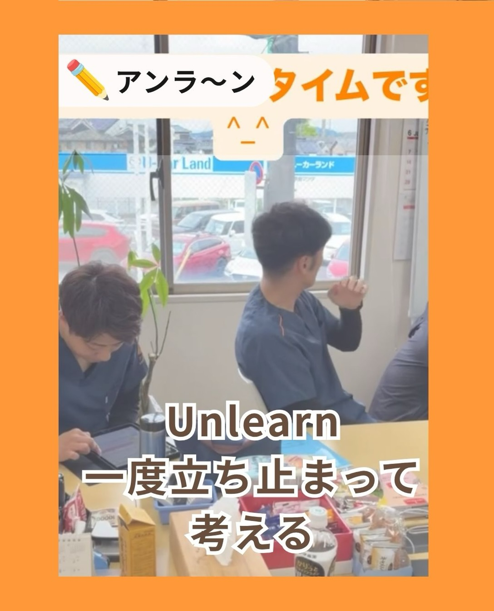
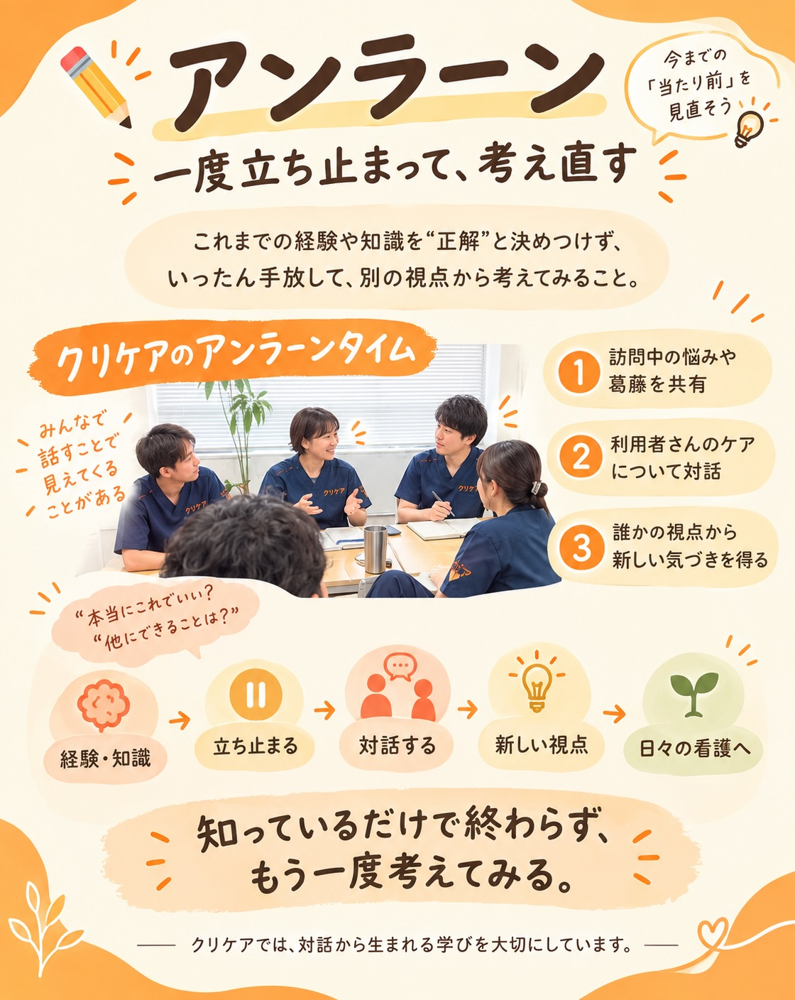

✍アンラーン

クリケアでは、
「アンラーン（Unlearn）」を大切にしています。

これまでの経験や知識をそのまま正解にするのではなく、
一度立ち止まって、
「本当にこれでいいのかな？」
「他にできることはないかな？」
と考えてみる。

毎週行っているアンラーンタイムでは、
訪問中に感じた悩みや葛藤、
利用者さんのケアについて感じたこと、
それぞれの思いをスタッフ同士で共有しています。

一人で考えているだけでは気づけなかったことも、
誰かと話すことで新しい視点が見えてくる。

そんな対話の積み重ねを、
日々の看護につなげています。

また、外部の専門家を招いた勉強会やイベントなど、
ステーションの中だけにとどまらない学びの機会も大切にしています。

「知っている」だけで終わらず、
一度ほぐして、もう一度考えてみる。

それが、クリケアのアンラーンです。

